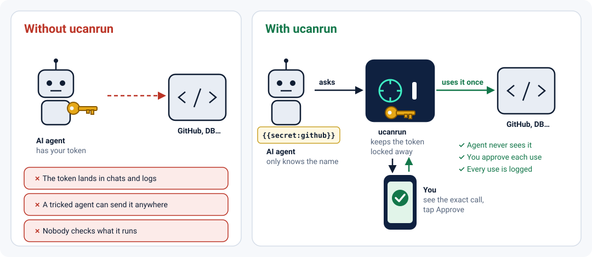

<p align="center"></p>

# ucanrun

A credential broker for AI agents, with a human in the loop. The command is `ucr`.

Your AI agent needs a GitHub token, a database password, an SSH key. Instead of handing it over, keep it in ucanrun: the agent asks, you approve on your phone, and ucanrun uses the secret for that one call. The agent never sees it.

<p align="center"></p>

## How it works

1. **You save a secret** with one line saying what it is for and which hosts may receive it.
2. **The agent lists secrets** over MCP: names and descriptions, never values.
3. **The agent sends a request** with `{{secret:name}}` where the secret goes.
4. **You approve** the exact request on Telegram, Discord, LINE, WhatsApp or the web, and **ucanrun runs it** and returns a redacted result.

<p align="center"></p>

Commands run on **runners**: `ucr runner` on another machine, which fetches approved jobs and runs only the programs its own allow list names. See [runners](docs/runners.md).

## Why

Giving an agent a token means the token ends up in transcripts, logs and model context, and a prompt injection can send it anywhere. With ucanrun the agent has nothing to leak, and every sensitive action needs your approval.

- Single small binary, no database.
- Default image is 12 MB with no shell.
- No API or MCP tool can read a secret value.
- Approvals show the real command, not the agent's description of it.
- MCP server for Claude Code, Cursor, Codex and others.
- Works from a phone as an installable web app.

## Quick start

```bash
git clone <repo> && cd ucanrun
docker compose up -d
docker logs ucanrun
```

No config file is needed. Open `http://127.0.0.1:8780`, enter the access code from the log, and follow the Start tab. See the [quick start](docs/quickstart.md).

On each machine where an agent runs, `ucr` comes from npm (Node 18 or later):

```json
{ "mcpServers": { "ucanrun": { "command": "npx", "args": ["-y", "ucanrun", "mcp"] } } }
```

Sign in once with `npx -y ucanrun login <agent-api-url>` and the token from the Agent tokens tab. Without Node, take the binary from the [releases](https://github.com/huydnd/ucanrun/releases). Runners install as a service; follow the Runner tab.

## Documentation

- [Quick start](docs/quickstart.md)
- [Configuration](docs/configuration.md)
- [Secret templates](docs/templates.md)
- [Agents on Windows](docs/windows.md)
- [Agent skill](skills/ucanrun/SKILL.md): copy to `~/.claude/skills/ucanrun`
- [Fixed actions (advanced)](docs/fixed-actions.md)
- [Creating profiles](docs/profiles.md)
- [Runners](docs/runners.md)
- [Approval channels](docs/channels.md)
- [Passkeys](docs/passkeys.md)
- [Security model](docs/security.md)
- [Troubleshooting](docs/troubleshooting.md)

## Development

```bash
mise install
cargo test
```

Set `UCANRUN_LIVE_TG_TOKEN` and `UCANRUN_LIVE_TG_CHAT` to run the test against the real Bot API. See [CONTRIBUTING](CONTRIBUTING.md) and [SECURITY](SECURITY.md).

## License

[MIT](LICENSE)
